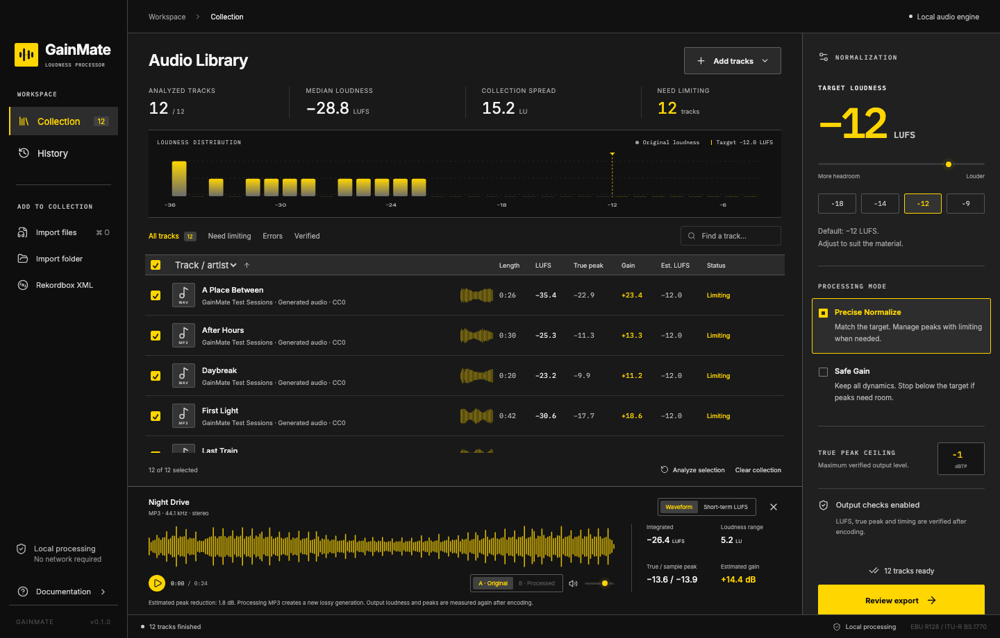

<p align="center"></p>
<h1 align="center">GainMate</h1>
<p align="center">Local loudness normalization for DJ libraries.</p>
<p align="center">
  <a href="https://github.com/BTFLV/Gainmate/actions/workflows/ci.yml"></a>
  <a href="LICENSE"></a>
  
</p>

GainMate measures perceived loudness, shows the adjustments your collection needs, and writes verified audio files. It runs locally with no account, subscription, telemetry or network connection required for audio processing.

Import your tracks, compare their loudness, choose a target, review the destination and normalize. Source files stay unchanged unless you explicitly choose replacement.



## Features

- MP3, PCM WAV and FLAC analysis and processing.
- Integrated LUFS, short-term/momentary loudness, LRA, sample peak and true peak.
- Loudness distribution, compact amplitude waveforms and a detailed timeline.
- Target previews that update immediately; sortable, searchable, virtualized track collection.
- **Precise Normalize** by default, with true-peak management when necessary.
- **Safe Gain** for uniform gain without dynamics processing.
- Exact decoded sample-count, rate, channel-layout, loudness and peak verification before committing output.
- Native file/folder dialogs, drag and drop, recursive import and canonical-path deduplication.
- Rekordbox XML collection, playlist and individual-track selection; missing-file reporting.
- Folder exports, optional folder hierarchy, explicit original replacement and byte-exact backups.
- Persistent analysis cache, session reopening, operation history and guarded restore.
- Original/processed preview at the same playback-volume setting, where the system webview supports the encoding.
- Two analysis workers, streaming decoding, serial normalization and cancellation.

## Download and install

[Download the latest release](https://github.com/BTFLV/Gainmate/releases/latest) → **Latest GainMate Release**.

Installers appear after the first successful release workflow on `main`. No remote release is created merely by setting up or testing this repository. A private repository requires GitHub access to its downloads.

| Platform                       | Artifact                             | Status                                              |
| ------------------------------ | ------------------------------------ | --------------------------------------------------- |
| macOS Apple Silicon, macOS 11+ | `GainMate_<version>_macos-arm64.dmg` | Native build validated locally                      |
| macOS Intel, macOS 11+         | `GainMate_<version>_macos-x64.dmg`   | Build/test workflow configured; not run locally     |
| Windows 10/11 x64              | `GainMate_<version>_windows-x64.exe` | NSIS installer workflow configured; not run locally |

**macOS:** open the DMG and drag GainMate into Applications. Current builds are ad-hoc signed unless Apple Developer credentials have been configured. Gatekeeper may block downloaded builds; use **System Settings → Privacy & Security → Open Anyway** after reviewing the source and download. Managed-device policies may require a signed/notarized release. Do not disable Gatekeeper globally.

**Windows:** run the EXE installer. It installs for the current user and uses WebView2. Windows SmartScreen can warn because Windows signing is not configured. WebView2 may require an initial download on systems without the runtime; audio processing subsequently works offline.

Matching source/license archives and SHA-256 checksums accompany release installers. Keep these when redistributing.

## Usage

1. **Import:** add audio files or recursive folders, or open a Rekordbox XML export. GainMate starts analysis automatically.
2. **Review:** sort/filter the collection, inspect the histogram and open a track's waveform or short-term loudness timeline. Check the estimated gain and limiting status.
3. **Configure:** choose the LUFS target, processing mode and true peak ceiling. −12 LUFS / −1 dBTP is a starting setting, not a universal DJ standard.
4. **Export:** select tracks, click **Review export**, choose an output folder and inspect created/replaced/backed-up/skipped counts and exact paths. Existing exports are never overwritten.
5. **Verify:** the engine decodes completed output and checks actual measurements and timing before committing it. History records achieved LUFS and true peak. Cancellation leaves already completed outputs valid.

Original replacement has a separate acknowledgement. Backups are enabled by default, stored beside originals in `.gainmate-backups`, or in your chosen backup folder. **History → Restore** checks both backup bytes and current-file hashes and refuses to overwrite files changed since normalization. Backups remain after restore. Keep adequate free space for temporary output and backups.

Shortcuts: `⌘/Ctrl O` import files; `⇧ ⌘/Ctrl O` import a folder; `⌘/Ctrl A` select the collection; `⌘/Ctrl Enter` review export. A waveform click or arrow key seeks preview playback. A/B switching keeps the timeline position and uses one shared playback volume; intentional loudness changes remain audible.

## Processing modes

|            | Precise Normalize                                                                       | Safe Gain                                           |
| ---------- | --------------------------------------------------------------------------------------- | --------------------------------------------------- |
| Processing | Constant gain where possible; FFmpeg oversampled loudness/peak processing when required | Constant gain only                                  |
| Dynamics   | May change when limiting is required                                                    | Preserved, apart from encoding/quantization effects |
| Target     | Must verify within ±0.3 LU before commit                                                | May remain below the target to respect peaks        |
| True peak  | Encoded output verified against the ceiling                                             | Encoded output verified against the ceiling         |

Precise processing refuses more than 6 dB of predicted peak reduction. Choose a quieter target or Safe Gain when a track needs excessive processing. There is no Metadata Only mode.

**MP3 is re-encoded with LAME V0**, adding a lossy generation. Original CBR/VBR and bitrate are not retained. MP3Gain frame adjustments are too coarse for arbitrary precise targets and cannot provide true-peak limiting; a lossless frame-editing path is not implemented. FLAC and PCM WAV avoid lossy encoding, but their sample values still change.

Standard tags and MP3/FLAC artwork are copied. Artist/title/album, artwork presence, sample count, sample rate and layout are verified. Proprietary tags, WAV RIFF chunks/cues/artwork and filesystem attributes are not guaranteed to survive. Unsupported layouts/encodings fail with an error, without damaging the source. See [audio behavior and limitations](docs/AUDIO.md).

## Rekordbox

Export your collection as XML in Rekordbox, then choose **Rekordbox XML** in GainMate. Browse playlists, select one or several playlists, or check individual tracks. Missing paths stay visible and cannot be selected. Locations must be accessible on the current computer; cross-computer path remapping is not implemented.

GainMate never edits Rekordbox's internal database or Pioneer device libraries. Folder exports need to be imported into Rekordbox separately. Replacing originals keeps their paths, but Rekordbox may need to reanalyze modified audio.

## Development

Requirements: Node.js 24+, npm, current stable Rust, and the [Tauri platform prerequisites](https://v2.tauri.app/start/prerequisites/). macOS needs Xcode Command Line Tools. Windows needs Visual Studio C++ Build Tools, WebView2 and MSYS2 MINGW64 for the audio tools. Leave several GB free for Rust dependencies and build artifacts.

```sh
npm ci
npm run audio:build
npm run desktop
```

`audio:build` downloads checksum-pinned FFmpeg/LAME sources and builds LGPL-only local sidecars. It requires a C compiler, make, pkg-config, curl, tar, xz, Perl and zlib headers. macOS system tools supply most requirements. On Windows, use the packages listed in `.github/workflows/release.yml` and run the script in MSYS2 with `GAINMATE_TARGET=x86_64-pc-windows-msvc`. Return to your normal terminal for `npm run desktop`.

`npm run dev` opens only the frontend development server; native import/processing is available in the desktop app. `npm run desktop` includes both Vite and Tauri. The launcher adds the standard Rust installation directory to PATH.

Production build:

```sh
# macOS
npm run package -- --bundles app,dmg
# Windows
npm run package -- --bundles nsis
```

Outputs are under `target/release/bundle`. The repository includes original SVG branding and generated platform icons; regenerate with `npm run icons` after editing `assets/icon.svg`.

Checks:

```sh
npm run check
npm run format:check
npm test
npm run test:ui
npm run build
cargo fmt --all --check
cargo clippy --workspace --all-targets --locked -- -D warnings
cargo test -p gainmate-core --locked -- --test-threads=2
```

Set `GAINMATE_FFMPEG` and `GAINMATE_FFPROBE` to the absolute bundled executable paths to test the exact release engine. Without those variables, core tests use FFmpeg/ffprobe on PATH. CI sets them explicitly. [Validation details](docs/VALIDATION.md) distinguish tests actually run locally from configured platform workflows.

### Architecture

`crates/gainmate-core` contains streaming measurement, SQLite cache/journal, import parsing, prediction, encoding, verification, transactional output and restore. `src-tauri` exposes narrow commands and job events. React/TypeScript renders the collection with TanStack Virtual, local fonts and Lucide icons. FFmpeg/ffprobe run as separate bundled processes; no external installation is needed in a packaged app.

See [contributing](CONTRIBUTING.md), [audio internals](docs/AUDIO.md) and [release/signing instructions](docs/RELEASING.md).

## CI, releases and signing

PRs and `main` pushes run quality checks. A successful `main` release run builds both macOS architectures and a Windows NSIS installer, then stages a complete artifact set before promoting the normal release **Latest GainMate Release** at mutable tag `latest`. The app's semantic version remains independent of that tag.

## License

GainMate's original code is [MIT licensed](LICENSE). Bundled FFmpeg/LAME impose LGPL obligations; several resolved Rust dependencies use MPL 2.0 and fonts use SIL OFL 1.1. Matching sources, build instructions and notices are included in release source archives. The application being MIT does not erase those obligations. See [third-party licensing](THIRD_PARTY.md).
